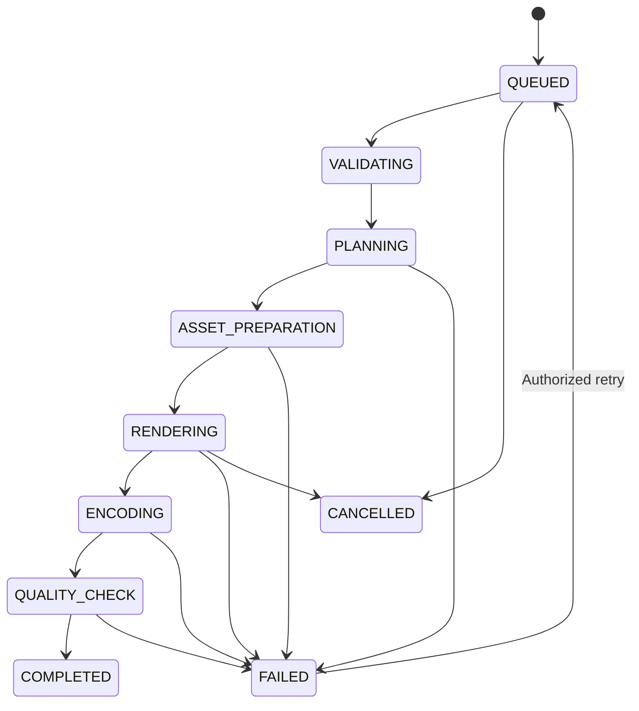

# TubeForge Whiteboard Engine — Engineering Implementation Plan

> Source document: user-approved implementation plan (imported from the project chat).
> Status documents that implement it: WHITEBOARD_ENGINE_AUDIT.md (E0),
> WHITEBOARD_ENGINE_DESIGN.md (E1), and the E2 prototype under
> `tubeforge/src/lib/tubeforge/whiteboard/`.

### TubeForge Whiteboard Engine — Engineering Implementation Plan

Objective: Engineer a native whiteboard video-generation engine inside TubeForge that can produce VideoScribe-style videos from a text prompt or script, with automated illustrations, realistic drawing animations, narration synchronization, camera movement, editing and MP4 export.

This is an implementation specification for the coding agent, not a claim that the features have already been built.

### 1\. Engineering objectives

The engine must satisfy six architectural requirements:

* Independent: Whiteboard must operate independently of Director.

* Native-first: Basic whiteboard generation must not require paid AI video APIs.

* Deterministic: The same project and rendering configuration must produce reproducible output.

* Editable: Every generated scene must remain editable.

* Scalable: Rendering must happen through controlled background jobs.

* Compatible: Existing TubeForge functionality must not regress.

### Target capabilities

| Capability    | Engineering target                   |
| ------------- | ------------------------------------ |
| Input         | Prompt, script or uploaded narration |
| Storyboard    | Automatic scene segmentation         |
| Illustration  | SVG-first asset pipeline             |
| Drawing       | Progressive SVG path animation       |
| Drawing hand  | Path-following pen animation         |
| Camera        | Pan, zoom and focus                  |
| Audio         | Voiceover, music and SFX             |
| Editing       | Scene and timeline editor            |
| Preview       | Low-resolution rendering             |
| Export        | 1080p MP4                            |
| Formats       | 16:9, 9:16, 1:1                      |
| AI dependency | Optional for core rendering          |

### 2\. Proposed system architecture

### TubeForge application layer

Whiteboard Studio UI

Prompt · Script · Scene editor · Timeline · Preview

Whiteboard Orchestrator

Project lifecycle · Planning · Asset selection · Render orchestration

Intelligence

Script parser, storyboard and scene planner

Asset service

SVG library, validation and matching

Animation runtime

Path drawing, hand, camera and transitions

Audio service

TTS, timing, mixing and synchronization

Composition and Rendering

Remotion · SVG · GSAP · FFmpeg

Output and Quality Control

MP4 · Preview · Validation · Storage

### Component ownership

| Component         | Responsibility                        |
| ----------------- | ------------------------------------- |
| Frontend          | Project creation and editing          |
| API               | Authorization and project operations  |
| Orchestrator      | Coordinates production stages         |
| Planner           | Generates structured scenes           |
| Asset service     | Retrieves and validates illustrations |
| Animation runtime | Calculates drawing and motion         |
| Render worker     | Produces video frames                 |
| Audio processor   | Synchronizes and mixes audio          |
| QC service        | Checks output correctness             |

The API must never perform long-running video rendering synchronously.

### 3\. Repository structure

The coding agent must inspect the existing repository before creating files. The following is the proposed logical structure; actual paths must follow TubeForge's current conventions.

```text
src/
├── engines/
│   ├── director/
│   │
│   └── whiteboard/
│       ├── index.ts
│       ├── whiteboard-engine.ts
│       ├── whiteboard-orchestrator.ts
│       │
│       ├── intelligence/
│       │   ├── script-parser.ts
│       │   ├── scene-planner.ts
│       │   ├── visual-matcher.ts
│       │   └── timing-planner.ts
│       │
│       ├── assets/
│       │   ├── asset-registry.ts
│       │   ├── svg-validator.ts
│       │   ├── path-extractor.ts
│       │   └── asset-matcher.ts
│       │
│       ├── animation/
│       │   ├── drawing-engine.ts
│       │   ├── hand-controller.ts
│       │   ├── camera-controller.ts
│       │   ├── transition-engine.ts
│       │   └── animation-timeline.ts
│       │
│       ├── audio/
│       │   ├── voiceover-adapter.ts
│       │   ├── audio-timing.ts
│       │   └── audio-mixer.ts
│       │
│       ├── rendering/
│       │   ├── composition.ts
│       │   ├── frame-renderer.ts
│       │   ├── video-encoder.ts
│       │   └── render-pipeline.ts
│       │
│       ├── qc/
│       │   ├── scene-validator.ts
│       │   ├── audio-validator.ts
│       │   └── render-validator.ts
│       │
│       └── schemas/
│           ├── project.schema.ts
│           ├── scene.schema.ts
│           ├── asset.schema.ts
│           └── animation.schema.ts
│
├── shared/
│   ├── providers/
│   ├── jobs/
│   ├── storage/
│   └── billing/
│
└── ...
```

Important: Do not create duplicate provider, job, billing or storage systems if equivalent infrastructure already exists.

### 4\. Core data contracts

All modules must communicate through versioned, validated data contracts.

### 4.1 Project schema

```ts
interface WhiteboardProject {
  id: string;
  version: number;
  engine: "whiteboard";

  title: string;
  script: string;

  settings: {
    width: number;
    height: number;
    fps: number;
    background: string;
    drawingStyle: string;
    handStyle: string;
  };

  scenes: WhiteboardScene[];

  audio: {
    narrationAssetId?: string;
    musicAssetId?: string;
  };

  status:
    | "draft"
    | "planning"
    | "ready"
    | "rendering"
    | "completed"
    | "failed";

  createdAt: string;
  updatedAt: string;
}
```

### 4.2 Scene schema

```ts
interface WhiteboardScene {
  id: string;
  order: number;

  narration: string;

  startMs: number;
  durationMs: number;

  assets: {
    assetId: string;
    layer: number;
  }[];

  events: AnimationEvent[];
  camera: CameraEvent[];
}
```

### 4.3 Asset schema

```ts
interface WhiteboardAsset {
  id: string;
  type: "svg" | "image";
  uri: string;

  metadata: {
    width: number;
    height: number;
    tags: string[];
    category: string;
  };

  paths?: {
    id: string;
    order: number;
    durationMs: number;
  }[];
}
```

### 4.4 Animation contract

```ts
type AnimationEvent =
  | {
      type: "draw";
      assetId: string;
      pathId: string;
      startMs: number;
      durationMs: number;
      easing: string;
    }
  | {
      type: "fade";
      assetId: string;
      startMs: number;
      durationMs: number;
    }
  | {
      type: "move";
      assetId: string;
      startMs: number;
      durationMs: number;
      from: { x: number; y: number };
      to: { x: number; y: number };
    }
  | {
      type: "color_reveal";
      assetId: string;
      startMs: number;
      durationMs: number;
    };
```

Use runtime schema validation, such as Zod if already present, rather than trusting TypeScript interfaces at API boundaries.

Also introduce:

* Schema versioning.

* Migration functions.

* Referential integrity checks.

* Maximum project and asset sizes.

* Deterministic serialization.

* Explicit coordinate-system conventions.

### 5\. Detailed engineering implementation

### Module 1 — SVG Asset Engine

Foundation

Purpose: Provide illustrations that can be progressively drawn.

Implementation:

* Load SVG assets.

* Parse SVG XML safely.

* Extract drawable paths.

* Normalize coordinate systems.

* Determine path lengths.

* Calculate drawing order.

* Assign animation durations.

* Store asset metadata.

Core technical approach:

```ts
const length = path.getTotalLength();

path.style.strokeDasharray = `${length}`;
path.style.strokeDashoffset = `${length}`;
```

Then progressively reduce `strokeDashoffset` to reveal the path.

However, the production renderer should not depend on browser DOM methods being available in the rendering worker. Use a compatible SVG parsing and rendering strategy.

Acceptance tests:

* Valid SVG loads successfully.

* Invalid SVG is rejected.

* Unsupported elements are handled safely.

* Multiple paths preserve their drawing order.

* Path lengths are calculated correctly.

* Assets can be reused across scenes.

### Module 2 — Drawing Hand Engine


Purpose: Simulate an actual person drawing illustrations.

Engineering process:

* Extract path geometry.

* Calculate total path length.

* Sample positions along the path.

* Calculate tangent direction.

* Position the hand at each sample.

* Rotate the pen to follow the tangent.

* Synchronize the hand with path reveal.

* Hide the hand when drawing is complete.

Mathematical foundation:

For a path , where is normalized arc length:

H(t)=P(s(t))

The pen orientation is determined by the path tangent:

\\theta(t)=\\operatorname{atan2}
\\left(
\\frac{dy}{ds},\\frac{dx}{ds}
\\right)

This prevents the hand from moving independently of the actual drawing.

Advanced features:

* Left-handed and right-handed styles.

* Pen and marker styles.

* Different drawing speeds.

* Natural pauses.

* Multiple drawing hands.

* Hand transitions between drawing objects.

Acceptance criteria: No visible gap between the pen tip and the active drawing endpoint during normal path-following animation.

### Module 3 — Storyboard Intelligence

Purpose: Transform a script into an actionable visual production plan.

Pipeline:

```text
Input script
    ↓
Sentence segmentation
    ↓
Semantic analysis
    ↓
Visual concept extraction
    ↓
Scene grouping
    ↓
Asset retrieval
    ↓
Drawing order
    ↓
Timing assignment
    ↓
Storyboard validation
```

Each scene should contain:

* Narration.

* Main visual concept.

* Supporting illustrations.

* Text overlays.

* Drawing sequence.

* Camera movement.

* Scene duration.

* Transition.

The planner should use a structured-output provider abstraction already available in TubeForge.

The native fallback should use deterministic rules and a searchable asset library. It should identify unsupported concepts rather than silently selecting unrelated illustrations.

Acceptance criteria: A five-minute script produces a valid, coherent storyboard with no missing scene references.

### Module 4 — Camera Engine

Purpose: Make the video feel dynamic instead of looking like a collection of static drawings.

Features:

* Pan.

* Zoom in.

* Zoom out.

* Follow drawing hand.

* Focus on important objects.

* Move between illustration clusters.

* Automatic canvas positioning.

Camera movement should use a virtual scene coordinate system.

A basic camera transformation can be expressed as:

\\begin{bmatrix}
x'\\\\y'\\\\1
\\end{bmatrix}
=
T_{\\text{camera}}
\\begin{bmatrix}
x\\\\y\\\\1
\\end{bmatrix}

Use interpolation to avoid sudden camera jumps.

Acceptance criteria: Camera movement never clips important illustration content or causes uncontrolled visual jitter.

### Module 5 — Audio Engine

Purpose: Synchronize voice and animation.

Processing sequence:

* Receive uploaded narration or generate TTS.

* Normalize audio format.

* Obtain phrase or word timestamps.

* Map narration segments to scenes.

* Assign drawing events.

* Add background music.

* Mix audio.

* Validate final duration.

The engine should account for:

* Speech pauses.

* Narration speed.

* Drawing speed.

* Scene transitions.

* Audio fade-in and fade-out.

* Music ducking.

If word-level timestamps are unavailable, use phrase-level timing or an explicit alignment service. Do not pretend that arbitrary sentence durations are accurate speech synchronization.

### Module 6 — Composition and Renderer

Purpose: Produce final frames and videos.

Proposed rendering stack:


SVG

Vector illustration and path drawing.


GSAP

Animation timelines and interpolation.


Remotion

Frame-based React video composition.


FFmpeg

Encoding, audio mixing and final output.

One important engineering decision: Remotion renders frame-based compositions. GSAP should not independently control a wall-clock animation during export. The renderer must evaluate animation state from the current frame/time so that output is deterministic.

Define a common interface:

```ts
interface WhiteboardRenderer {
  renderPreview(
    project: WhiteboardProject
  ): Promise<PreviewResult>;

  renderFinal(
    project: WhiteboardProject
  ): Promise<RenderResult>;

  cancel(
    jobId: string
  ): Promise<void>;
}
```

The actual method signatures should match the existing TubeForge job and renderer conventions.

Acceptance criteria:

* Correct frame dimensions.

* Correct frame rate.

* Correct animation timing.

* Valid MP4 output.

* Synchronized audio.

* No corrupted frames.

* Repeatable output for the same inputs.

### 6\. API engineering

The frontend should communicate with the engine through versioned APIs.

Proposed endpoints:

| Method | Endpoint                             | Purpose                |
| ------ | ------------------------------------ | ---------------------- |
| POST   | /api/whiteboard/projects             | Create project         |
| GET    | /api/whiteboard/projects/:id         | Retrieve project       |
| PATCH  | /api/whiteboard/projects/:id         | Update project         |
| POST   | /api/whiteboard/projects/:id/plan    | Generate storyboard    |
| POST   | /api/whiteboard/projects/:id/preview | Render preview         |
| POST   | /api/whiteboard/projects/:id/render  | Start final rendering  |
| GET    | /api/whiteboard/jobs/:id             | Check rendering status |
| POST   | /api/whiteboard/jobs/:id/cancel      | Cancel rendering       |
| GET    | /api/whiteboard/assets               | Search illustrations   |
| POST   | /api/whiteboard/assets               | Upload illustration    |

These routes are proposed. Reuse existing API versioning, authentication, authorization and error-response conventions.

### API security requirements

* Every project must have an authorized owner.

* Users cannot access another user's assets or renders.

* Validate all uploaded files.

* Reject unsafe SVG content.

* Prevent arbitrary file paths.

* Restrict remote asset fetching to prevent SSRF.

* Enforce request-size limits.

* Rate-limit expensive operations.

* Protect render jobs against duplicate submissions.

* Validate project state transitions.

SVG is an important attack surface. Disallow scripts, event handlers, external references and unsafe embedded content. Rasterize or sanitize uploaded assets before they enter the trusted rendering pipeline.

### 7\. Background rendering and job orchestration

The renderer should operate independently from web requests.

Proposed state machine:



Every job should record:

```ts
interface RenderJob {
  id: string;
  projectId: string;
  status: string;

  progress: number;
  currentStage: string;

  attempts: number;
  maxAttempts: number;

  startedAt?: string;
  completedAt?: string;

  errorCode?: string;
  outputAssetId?: string;
}
```

### Reliability requirements

* Idempotent job submission.

* Safe retries.

* Render checkpoints.

* Worker heartbeat.

* Timeout detection.

* Job cancellation.

* Temporary file cleanup.

* Storage quota enforcement.

* Failure diagnostics.

A failed render should not destroy the user's project or storyboard.

### 8\. Frontend engineering

The editor needs five principal views.

### Whiteboard Studio interface

A. Project creation


Prompt, script, duration, aspect ratio and style.

B. Storyboard


Scene ordering, narration and illustration selection.

C. Animation preview


Drawing hand, progressive illustrations and camera movement.

D. Timeline editor


Visual tracks, audio, scene duration and animation events.

E. Export


Quality, format, resolution, progress and download.

The editor must support autosaving, undo/redo, scene duplication and restoration of the last valid project version.

### 9\. Testing architecture

Testing must be established before feature implementation.

| Layer       | Required coverage                |
| ----------- | -------------------------------- |
| Unit        | SVG paths, timing, transforms    |
| Contract    | Project and scene schemas        |
| Integration | Planner to renderer              |
| API         | Authentication and authorization |
| Security    | SVG, uploads, SSRF               |
| Visual      | Frame snapshots and clipping     |
| Audio       | Duration and synchronization     |
| Performance | Rendering time and memory        |
| Regression  | Director and existing products   |

### Required automated scenarios

* SVG containing malicious scripts is rejected.

* SVG with thousands of paths does not cause unbounded processing.

* Missing illustration does not silently produce a misleading scene.

* Narration longer than the scene is detected.

* A cancelled job does not publish incomplete output.

* Duplicate render requests do not create uncontrolled duplicate jobs.

* Worker restart does not corrupt the project.

* Two users cannot access each other's projects.

* Director still generates videos after Whiteboard integration.

### Benchmark targets

These are proposed engineering targets, to be measured against actual hardware:

| Metric                | Target                                 |
| --------------------- | -------------------------------------- |
| Preview resolution    | 720p                                   |
| Final resolution      | 1080p                                  |
| Standard output       | 30 FPS                                 |
| Initial prototype     | 60-second video                        |
| Initial scene count   | 5–15                                   |
| Rendering determinism | Same inputs, same frame output         |
| Project integrity     | Zero lost saved edits                  |
| Security              | No known critical/high vulnerabilities |

Don't impose an arbitrary render-time target until the first performance benchmark establishes a baseline.

### 10\. Deployment and infrastructure

The production architecture should separate application requests from rendering workloads.

```text
                  TubeForge Frontend
                         |
                    API Server
                         |
                   Job Scheduler
                         |
                 Persistent Job Queue
                         |
             +-----------+-----------+
             |           |           |
          Worker 1    Worker 2    Worker 3
             |           |           |
             +-----------+-----------+
                         |
                  Object Storage
                         |
                   Final MP4
```

Recommended controls:

* Independent render-worker scaling.

* Worker CPU and memory limits.

* Temporary storage isolation.

* Persistent job records.

* Encrypted storage where appropriate.

* Signed download URLs.

* Render concurrency limits.

* Monitoring and error tracking.

The first release should use the simplest queue and storage infrastructure compatible with TubeForge's existing deployment. Avoid premature infrastructure expansion.

### 11\. Engineering milestone and acceptance matrix

This is the implementation control sheet.

| Milestone | Deliverable        | Exit gate                  |
| --------- | ------------------ | -------------------------- |
| E0        | Repository audit   | Architecture approved      |
| E1        | Project foundation | Valid project creation     |
| E2        | SVG pipeline       | Safe vector rendering      |
| E3        | Drawing engine     | Progressive path animation |
| E4        | Hand controller    | Path-following hand        |
| E5        | Storyboard         | Prompt-to-scenes           |
| E6        | Audio              | Narration synchronization  |
| E7        | Camera             | Smooth pan and zoom        |
| E8        | Renderer           | Working MP4                |
| E9        | Editor             | Editable timeline          |
| E10       | QC                 | Benchmark PASS             |
| E11       | Security           | Security review PASS       |
| E12       | Production         | Release readiness PASS     |

No milestone should be marked complete just because code has been written. It must satisfy its exit gate.

### 12\. Resource and API budget engineering

The initial testing budget remains $5.

The engineering strategy should prioritize local computation and existing provider integrations.

| Operation                  | API spending |
| -------------------------- | ------------ |
| SVG drawing                | $0 API       |
| Hand animation             | $0 API       |
| Camera movement            | $0 API       |
| Scene composition          | $0 API       |
| FFmpeg encoding            | $0 API       |
| Native storyboard fallback | $0 API       |
| LLM storyboard assistance  | Usage-based  |
| TTS                        | Usage-based  |
| AI illustration            | Optional     |
| AI video generation        | Optional     |

The $5 is a testing cap, not an expected production cost. Track every external request, estimate its cost before execution and stop before exceeding the cap.

Do not purchase new subscriptions or introduce a new paid provider without approval.

### 13\. Implementation rules for the coding agent

These rules are mandatory.

Architecture

* Inspect before modifying.

* Preserve Director.

* Reuse existing provider abstractions.

* Reuse existing authentication and billing.

* Avoid duplicate infrastructure.

* Keep Whiteboard modular.

Code quality

* TypeScript strictness.

* Runtime validation.

* No unexplained `any`.

* No silent fallback on critical failures.

* No hardcoded secrets.

* Document architectural decisions.

* Keep functions testable and deterministic.

Testing

* Run targeted tests after every milestone.

* Run full regression tests before integration.

* Record test results.

* Fix regressions before proceeding.

* Never report unexecuted tests as passing.

Security

* Sanitize SVG.

* Validate uploaded assets.

* Prevent unauthorized project access.

* Prevent SSRF and arbitrary file access.

* Restrict render resources.

* Secure output storage.

Project governance

Every engineering report must use:

* PASS

* PARTIAL

* FAIL

* BLOCKED

* NOT VERIFIED

### 14\. Immediate execution plan

Do not ask the coding agent to build the entire engine in one operation.

Start with these three deliverables:

First task

E0 — Full repository audit

Inspect current default branch, HEAD, Director, rendering pipeline, providers, jobs, billing, tests and security.

Deliverable: `WHITEBOARD_ENGINE_AUDIT.md`

Second task

E1 — Technical design

Finalize module boundaries, data schemas, renderer integration and test strategy.

Deliverable: `WHITEBOARD_ENGINE_DESIGN.md`

Third task

E2 — Working prototype

Build a small independent renderer capable of drawing an SVG illustration with an animated hand and exporting a 60-second MP4.

Deliverable: Executable prototype and automated tests.

### 15\. Master engineering prompt

This is the instruction I would give your coding agent.

# TubeForge Whiteboard Engine — Master Engineering Assignment

## Mission

Engineer an independent, native-first Whiteboard Animation Engine inside TubeForge, capable of producing professional VideoScribe-style videos from text prompts, scripts and uploaded narration.

The engine must support automated storyboard creation, SVG illustration, progressive drawing, realistic drawing-hand animation, camera movement, audio synchronization, scene editing and MP4 rendering.

## Existing project constraints

1. Inspect the current GitHub default branch and HEAD before making assumptions.
2. Preserve the existing Director engine and all working functionality.
3. Reuse existing provider abstractions, authentication, billing, storage, job orchestration and rendering infrastructure wherever appropriate.
4. Do not duplicate existing services.
5. Keep Whiteboard independent from Director's production logic.
6. Native SVG animation and rendering must not require paid AI video-generation APIs.
7. Initial external API testing budget: $5 maximum.
8. Do not introduce paid dependencies without approval.

## Development sequence

E0. Read-only repository audit.

E1. Technical architecture and schema design.

E2. SVG asset pipeline.

E3. Progressive drawing engine.

E4. Path-following drawing-hand controller.

E5. Script-to-storyboard intelligence.

E6. Audio and narration synchronization.

E7. Camera and transition engine.

E8. Remotion/renderer integration and MP4 export, subject to compatibility benchmarking.

E9. Timeline and scene editor.

E10. Quality control and benchmark suite.

E11. Security, performance and cost hardening.

E12. Production integration.

## First assignment: E0

Do not modify application code.

Inspect:
- Default branch and current HEAD.
- Repository architecture.
- Director engine.
- Existing rendering implementation.
- Provider abstractions.
- Storyboard and scene schemas.
- Animation and motion systems.
- Audio processing.
- Job queues and workers.
- Storage.
- Authentication and billing.
- CI workflows and tests.
- Security boundaries.
- Deployment configuration.

Identify reusable components, missing components, architectural conflicts and implementation risks.

Produce WHITEBOARD_ENGINE_AUDIT.md with:
- Executive summary.
- Verified current repository state.
- Existing reusable components.
- Proposed module boundaries.
- Dependency analysis.
- Security risks.
- Testing gaps.
- Recommended implementation order.
- Explicit blockers.

## Engineering requirements

Use TypeScript and runtime schema validation.

Implement deterministic frame-based animation.

Use SVG path geometry for progressive drawing and actual path-following hand movement.

Use a shared coordinate system for drawing, hand movement and camera transforms.

Synchronize narration against actual audio timing.

Support scene-level rendering and caching.

Implement idempotent background rendering jobs.

Validate all project inputs and uploaded assets.

Sanitize SVG and prohibit unsafe embedded content.

Ensure user project ownership and output isolation.

Preserve project state across worker failures.

## Mandatory acceptance criteria

The first prototype must:
1. Load a valid SVG.
2. Extract and order its paths.
3. Progressively draw those paths.
4. Move a drawing hand along the active path.
5. Support multiple illustrations.
6. Render deterministic frames.
7. Export a playable 1080p MP4.
8. Include automated tests.

Subsequent releases must add automated storyboard generation, narration synchronization, camera controls, editing, and production monitoring.

## Quality gates

Every milestone requires:
- Implementation evidence.
- Automated test results.
- Security review where applicable.
- Regression testing.
- Documented limitations.
- A clear PASS/PARTIAL/FAIL/BLOCKED/NOT VERIFIED result.

Never claim tests passed unless they were actually executed.

Never break or silently alter Director behavior.

Do not proceed to the next milestone if the current milestone has unresolved critical defects.

## Reporting format

For every task, report:
1. Current repository HEAD.
2. Files inspected.
3. Files created or modified.
4. Implementation completed.
5. Tests executed and results.
6. Security implications.
7. Cost implications.
8. Remaining blockers.
9. Exit-gate status.
10. Recommended next task.

Start with E0. Do not begin implementation until the audit and architecture have been reviewed.

### Final engineering recommendation

The most important decision is to prove the native drawing engine before investing heavily in AI intelligence or the editor.

Your first engineering milestone is a working 60-second VideoScribe-style MP4, generated using native rendering, SVG paths, a synchronized drawing hand and narration.

Once that works reliably, TubeForge has a solid foundation for a much larger video-production platform.
